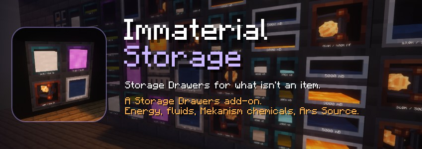

# Store copy

Paste-ready text for the CurseForge and Modrinth project pages, same layout as Immaterial Drawers'.
Not documentation: this file sells the mod. Every claim here is something the mod does today: check
it against `CHANGELOG.md` before changing a number.

Images live in `docs/store-art/` and the description links them from GitHub
(`raw.githubusercontent.com`, `main`), never from the description editor: an image uploaded there
joins the CurseForge gallery.

**Images still to make** (none is in `docs/store-art/` yet): the banner and the section headers, in
Immaterial Drawers' style, and the captures, taken without HUD. Their file names are fixed below.

## Name

Immaterial Storage - A Storage Drawers Addon

## Summary

> One line, 256 characters at most, shown under the name in every search result.

Storage Drawers drawers for what isn't an item: Energy (7 billion FE), fluids, Mekanism chemicals and Ars Nouveau Source. Same upgrades, same controllers, same framing table.

## Description

<!-- Everything below this line is pasted into the site's Markdown editor as-is. -->

**Storage Drawers stores items. Immaterial Storage stores everything else.**

Drawers for the things you can't pick up: power, fluids, Mekanism chemicals, Ars Nouveau Source.
They sit in your wall of drawers, take the upgrades you already craft, join your Drawer Controller
like any other drawer and go through the Framing Table. If you know Storage Drawers, you already
know how to use this.

- ✅ **Energy Drawer**, Forge Energy. Works with every FE mod.
- ✅ **Fluid Drawers**, in 1x1, 1x2 and 2x2.
- ✅ **Chemical Drawers**, for Mekanism gases, slurries, pigments and infuse types, in 1x1, 1x2 and
  2x2. *With Mekanism.*
- ✅ **Source Drawer**, for Ars Nouveau Source. *With Ars Nouveau.*
- 💡 Want something else stored? Say so in the [issues](https://github.com/DrimoZ/ImmaterialStorageDrawers/issues).

- **500,000 FE out of the box**, and Storage Drawers' own Storage Upgrades take it to about
  **7.2 billion FE** with seven Netherite. No new upgrade items.
- **An energy cube turns inside every drawer**: no core when empty, faint when low, blazing when
  full. Read a whole wall from across the room.
- **Numbers that don't lie.** Counted in 64 bits: the drawer front, Jade and The One Probe show the
  real total, even past the 2.1 billion where most FE blocks stop counting.

- **One fluid per compartment**, in 1x1, 1x2 and 2x2, like Storage Drawers' own 1, 2 and 4 drawers.
  A bucket fills or empties the compartment you click.
- **Chemical Drawers** do the same for Mekanism: a chemical tank in hand fills or empties a
  compartment, tubes connect on every side, and gases glow in their tank.

- **A Source Jar in a drawer.** Relays, the enchanting apparatus, imbuement and sourcelinks find it
  on their own.

Put the drawers next to a **Drawer Controller**, as you would any drawer, and connect one cable,
pipe or tube to the controller or a Controller Slave: the whole wall fills and drains as one store,
compartments already holding a fluid or chemical first. Jade and The One Probe show what it holds.

- **Storage Drawers' upgrades**, 7 slots: storage, void, creative storage, creative vending. Sneak and
  right-click with an empty hand for the upgrade screen you already know.
- **The Framing Table** frames every drawer, and the frame shows in your inventory too.
- **Break a drawer and keep everything**: contents, upgrades and frame stay in the item.

## Requires

- Minecraft 1.21.1, NeoForge
- Storage Drawers 13.11.4+
- Optional: Mekanism 10.7+ (Chemical Drawers), Ars Nouveau 5.13+ (Source Drawer), Jade or The One
  Probe (readouts)

## Gallery

Uploaded by hand to each site, from the same captures as the description images:

- `wall_overview`: a wall of every drawer type around a controller
- `energy_close`: energy drawers at 0, 50 and 100 %
- `fluids_close`: fluid drawers in 1x1, 1x2 and 2x2
- `chemicals_close`: chemical drawers, gases glowing
- `framed`: framed drawers, and their icons in the hotbar
- `probes`: Jade and The One Probe on a controller
- `upgrade_screen`: the upgrade screen of a 2x2 drawer
